<!-- art is generated by scripts/: make_heatmap.py -> make_ascii_portrait.py -> make_info_card.py -->

<h3><code>~/sanskar $ ./contributions.sh</code></h3>

  

<h3><code>~/sanskar $ whoami</code></h3>

<table>
  <tr>
    <td valign="top"></td>
    <td valign="top"></td>
  </tr>
</table>

 

<h3><code>~/sanskar $ ./snake --eat contributions</code></h3>

<picture>
  <source media="(prefers-color-scheme: dark)" srcset="https://raw.githubusercontent.com/GubreleySanskar/GubreleySanskar/output/github-snake-dark.svg"/>
  <source media="(prefers-color-scheme: light)" srcset="https://raw.githubusercontent.com/GubreleySanskar/GubreleySanskar/output/github-snake.svg"/>
  
</picture>

  

<h3><code>~/sanskar $ ./links.sh</code></h3>

<b>Software Engineer @ Salesforce · Tech &amp; AI Content Creator</b>

<!-- INSTAGRAM --><!-- LINKEDIN --><!-- X -->

 

